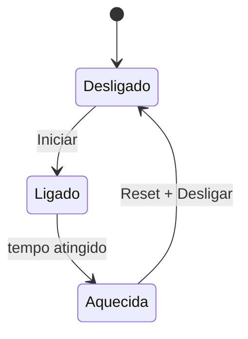

# Ep.MicroOndas.Wpf

## Visão geral

Aplicação desktop WPF (.NET Framework 4.6.1, C#) que modela o comportamento de um micro-ondas: o usuário informa tempo e potência, inicia o aquecimento e acompanha o status (`Desligado`, `Ligado`, `Aquecida`) na janela principal. A validação, o temporizador e as transições de estado ficam em camadas separadas da interface, com injeção de dependência via Ninject.

Não há documento de requisitos no repositório. O histórico de commits (ex.: "Atendendo Requisito Nivel 1") sugere projeto de estudo ou exercício (inferido de `git log`).

## Objetivo

Inferido do código, pois não há documentação de requisitos: exercitar a separação em camadas de uma aplicação WPF e a modelagem das regras de um micro-ondas (validação de entrada, contagem por tempo e estados) com o padrão State e IoC.

Não foram identificados usuário final, integrações externas, persistência nem público-alvo.

## Funcionalidades

Evidentes no código:

- Entrada de **tempo** (em segundos, intervalo 1 a 120) e **potência** (intervalo 1 a 10) por `TextBox` ligados à entidade via data binding.
- Validação ao iniciar: o tempo é obrigatório e deve estar no intervalo; a potência só é validada se for numérica; potência vazia assume o padrão `10`.
- Botão **Iniciar**: executa com os valores digitados.
- Botão **Aquecimento Rápido**: preset com tempo `30` e potência `8` (`MicroOndasEntity.InstanciaInicioRapido`).
- Contagem com `System.Timers.Timer` a cada 1000 ms. A cada tick, acrescenta à string de progresso um ponto por unidade de potência, escrita em `Console`.
- Ao atingir o tempo: estado `Aquecida`, campos Tempo e Potência limpos e retorno a `Desligado`.
- Label de status ligada à propriedade `Status`.

## Arquitetura

### Projetos e responsabilidades

| Projeto | Tipo | Responsabilidade principal | Depende de |
| --- | --- | --- | --- |
| `Ep.MicroOndas.Wpf` | WinExe | Ponto de entrada (`App.xaml.cs`, composição via Ninject) e janela (`MainWindow`) | Dominio, Ioc, Servicos |
| `Ep.MicroOndas.Ioc` | Library | Registro de dependências (`IocBase.Injecao`) | Dominio, Regras, Servicos |
| `Ep.MicroOndas.Servicos` | Library | Fachada `MicroOndasServico` entre a UI e as regras | Dominio, Regras |
| `Ep.MicroOndas.Regras` | Library | `MicroOndasRegra` (validação, timer, transições) e estados em `state/` | Dominio |
| `Ep.MicroOndas.Dominio` | Library | `MicroOndasEntity` (tempo, potência, status; `INotifyPropertyChanged`) | nenhum |

### Padrões

- **Injeção de dependência** (Ninject 3.3.4): `IocBase` liga `IMicroOndasRegra` e `IMicroOndasServico` em escopo transient.
- **State**: `AbstractMicroOndaState` com `MicroOndaStateDesligado`, `MicroOndaStateLigado` e `MicroOndaStateAquecida`. Cada estado é uma instância estática criada sob demanda e compartilhada.
- **Fachada**: `MicroOndasServico` expõe `ConfiguracaoInicialMicroOndas()` e `Inicio()` para a UI.
- **Data binding / INotifyPropertyChanged**: a janela usa a `MicroOndasEntity` como `DataContext`. Os handlers de clique ainda estão no code-behind de `MainWindow`, então o padrão MVVM não é completo.

### Fluxo principal: iniciar aquecimento

```
MainWindow.Button_Click
  -> MicroOndasServico.Inicio(entidade)
     -> MicroOndasRegra.ConfigureMicroOndas(entidade)
     -> MicroOndasRegra.Iniciar()    valida Tempo/Potencia, cria Timer (1000 ms)
     -> MicroOndasRegra.Ligar()      estado Ligado; Timer.Start()
        ... a cada tick: EventoTimer -> contador++ -> ValidarFinalizar()
        ... ao atingir o tempo: estado Aquecida -> Reset() -> Desligar()
            (estado Desligado; Timer.Stop/Dispose)
```

Na inicialização, `App.OnStartup` cria um `StandardKernel`, chama `Injecao()`, obtém `MainWindow` (cujo construtor recebe `IMicroOndasServico`) e exibe a janela. `ConfiguracaoInicialMicroOndas()` cria a entidade e coloca a regra em `Desligado`.

Transições de estado:



### Tecnologias e versões

- C#. A versão da linguagem não está fixada nos `.csproj`; o código usa recursos de C# 7 (inferido).
- .NET Framework 4.6.1 (`TargetFrameworkVersion v4.6.1` em todos os projetos).
- WPF: PresentationFramework, PresentationCore, WindowsBase, System.Xaml.
- Ninject 3.3.4 (`packages.config` e referência nos `.csproj` de Wpf e Ioc).
- `System.Timers.Timer` (BCL).
- Visual Studio 16 (`VisualStudioVersion = 16.0.29920.165` no `.sln`). Os `.csproj` estão no formato antigo (`ToolsVersion="15.0"`, não SDK-style).

### Estrutura de pastas (resumida)

```
Ep.MicroOndas.Wpf.sln
├── Ep.MicroOndas.Wpf/        UI: App.xaml, MainWindow.xaml(.cs), IMainWindow.cs
├── Ep.MicroOndas.Ioc/        IocBase.cs (bindings Ninject)
├── Ep.MicroOndas.Servicos/   interfaces/, objetos/ (MicroOndasServico)
├── Ep.MicroOndas.Regras/     regra/ (MicroOndasRegra), state/ (estados)
├── Ep.MicroOndas.Dominio/    entidades/ (MicroOndasEntity)
└── packages/                 Ninject 3.3.4 (versionado no repositório)
```

Testes: nenhum projeto de teste identificado.

## Como executar e testar

Status: **não executado/validado**. Os passos abaixo são inferidos dos arquivos de projeto.

1. Windows com Visual Studio 2019 (ou MSBuild) e o targeting pack do .NET Framework 4.6.1.
2. A pasta `packages/` está no repositório e o `HintPath` aponta para ela. O restore NuGet parece desnecessário (inferido de `Ep.MicroOndas.Wpf.csproj`).
3. Abrir `Ep.MicroOndas.Wpf.sln`, definir `Ep.MicroOndas.Wpf` como projeto de inicialização e executar na configuração `Debug|AnyCPU`.
4. Linha de comando (exemplo, não executado): `msbuild Ep.MicroOndas.Wpf.sln /p:Configuration=Debug`.
5. Testes automatizados: não há projeto de testes.

## Observações

Limitações e dívidas técnicas visíveis no código. Nada disso foi reproduzido em execução.

- **Potência não numérica derruba o timer.** `PotenciaValidar` só valida valores numéricos. Um texto como `abc` passa, e `AtualizarAdicional` faz `int.Parse` no tick, lançando `FormatException` na thread do timer.
- **Exceções de validação não tratadas na UI.** `ArgumentException` de `TempoValidar` e `PotenciaValidar` não é capturada em `MainWindow`, e a mensagem não é mostrada ao usuário.
- **Reinício durante o aquecimento.** Os botões não são desabilitados, e `Iniciar()` cria um novo `Timer` sem parar o anterior. Não há botão para parar ou cancelar; `Desligar()` só é chamado internamente.
- **Atualização da UI a partir de thread de pool.** `EventoTimer` roda na thread do `System.Timers.Timer` e altera propriedades bindadas sem `Dispatcher`. O comportamento não foi verificado em execução.
- **Status `Aquecida` transitório.** `ValidarFinalizar` define `Aquecida` e, em seguida, `Desligar()` define `Desligado` no mesmo tick.
- **Registros de IoC não usados.** `Bind<MicroOndasEntity>` (singleton) e `Bind<Timer>` não participam do fluxo: a entidade vem de `InstanciaInicio` e o timer de `new Timer()`.
- **Construtor sem parâmetros.** `MainWindow()` chama `Close()` antes de `InitializeComponent()`. Não é o construtor usado pelo Ninject; parece código morto.
- **Nomes de botões invertidos.** `ViewBotaoIniciarRapido` exibe "Iniciar" e `ViewBotaoIniciar` exibe "Aquecimento Rápido".
- **Progresso só no Console.** A contagem de pontos vai para `Console.WriteLine`, não para a interface.
- **Arquivos gerados versionados.** `bin/`, `obj/`, `packages/` e `.vs/*.suo` estão no git apesar do `.gitignore`: 87 arquivos rastreados que o `.gitignore` ignoraria. Sugestão: remover do índice com `git rm --cached` (não aplicado).
- **Stack legada.** .NET Framework 4.6.1 e `.csproj` no formato antigo. Migrar para .NET moderno exige conversão.
- **Sem testes automatizados.** `TempoValidar`, `PotenciaValidar` e as transições de estado são candidatas naturais a testes unitários.
- **Idiomas misturados.** Nomes de código misturam português e inglês (ex.: `EstabelecerEstado`, `Iniciar`, `ConfigureMicroOndas`). Mensagens e UI estão em PT-BR.
- **Não identificados:** licença, requisitos formais, contexto acadêmico e público-alvo.
